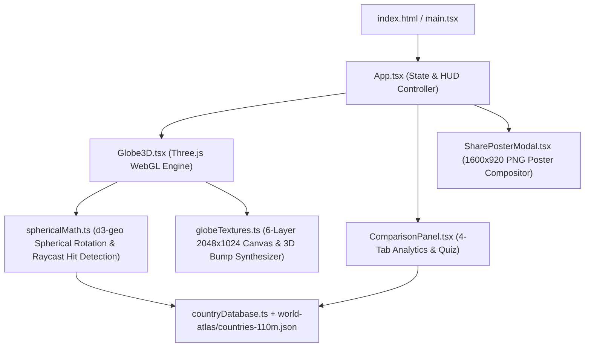

# Kuson Globe Compare — Comprehensive Handoff, Specifications & State Documentation

> **Repository**: `https://github.com/kuson/kuson_globe_compare`  
> **Local Workspace**: `/Volumes/ExtremeProApple/dev/2026/kuson_globe_compare`  
> **Conversation / Session ID**: `47e2c7d6-e449-4f42-98ce-b45e24fb2738`  
> **Status**: Production-ready, TypeScript-verified (`tsc -b && vite build`), Browser-verified (`1440×900` zero console/network errors), and pushed to `origin/main`.

---

## 1. Product Vision & Specifications

**Kuson Globe Compare** is an interactive 3D WebGL globe application that superimposes a chosen country (defaulting to **Thailand 🇹🇭**, ISO-3166-1 numeric `764`) over a customizable 3D Earth globe. Users can drag, teleport, or rotate the superimposed country anywhere on the planet with **zero map projection distortion** while inspecting head-to-head vital statistics, counterfactual simulations, expat/travel intelligence, and shareable infographics comparing the **Dragged Nation** and the **Underlying Target Nation(s)**.

### Target User Personas & 10x Feature Matrix
1. **Educators, Teachers & Students (K-12, AP Human Geography, University)**
   - **True Spherical Rotation**: Eliminates flat Web Mercator distortion ($\sec^2(\phi)$ area inflation near the poles).
   - **Mercator Projection Mythbuster**: Live calculator and visual side-by-side box comparison showing how much a flat Web Mercator map inflates the dragged country's apparent area at the current latitude.
   - **Mind-Blowing Scale Tours**: 7 curated 1-click presets (*Thailand over Western Europe*, *Thailand over UK*, *Thailand over US East Coast*, *Thailand over Japan*, *Greenland over Africa*, *Indonesia over USA*, *Chile across Europe*).
   - **Interactive Scale Quiz**: Built-in multi-question geography & scale challenge with instant 3D camera fly-to verification.
2. **Economists, Analysts & Policy Researchers**
   - **5-Dimension Scale Fingerprint**: Normalized SVG radar chart comparing Land Area, Population, Total GDP, GDP per Capita, and Population Density.
   - **Head-to-Head Vital Statistics**: Proportional comparison bars for Land Area ($\text{km}^2$), Population, Population Density ($\text{/km}^2$), Nominal GDP, GDP (PPP), GDP per Capita, Human Development Index (HDI), Life Expectancy, Median Age, Highest Peak Elevation, Coastline Length, and Forest Cover %.
   - **Counterfactual "What-If" Simulator**: Computes what the dragged country's total population would be at the target country's population density, what its total GDP would be at the target country's GDP per capita, and reverse density projections.
   - **Global Statistical Choropleth Heatmap Layer**: Shades all countries on the 3D globe by `gdpPerCapita`, `populationDensity`, `gdpNominalB`, `hdi`, or `areaKm2`.
3. **Global Travelers, Digital Nomads & Expats**
   - **Purchasing Power Parity (PPP) Lifestyle Equivalent Calculator**: Interactive monthly budget slider (`$1,000`–`$10,000/mo`) comparing Cost of Living Indices between the dragged and target countries.
   - **Great-Circle Geodesic Telemetry**: Calculates exact spherical distance (`km` and `mi`), estimated non-stop flight duration (`hrs`), compass bearing, average temperature differential (`°C`), currency, driving side (`Left` vs `Right`), and timezone.
4. **Content Creators, Journalists & Social Sharers**
   - **Viral Infographic Studio (`SharePosterModal`)**: Composites the live Three.js WebGL canvas (`preserveDrawingBuffer: true`) with an editorial comparison card into a downloadable `1600×920` `.PNG` poster.
   - **Interactive 3D Deep Links**: Encodes the complete comparison state into URL query parameters (`?drag=764&target=826&lng=-1.80&lat=53.50&rot=0&layer=political`) and copies pre-formatted viral summary text to the clipboard.

---

## 2. Technical Architecture & Implementation Plan



### Core Mathematical & Rendering Pipeline
1. **Spherical Coordinate Mapping (`src/utils/sphericalMath.ts`)**:
   - Converts geographic $(\text{lat}, \text{lng})$ to 3D Cartesian coordinates matching Three.js `SphereGeometry` UV layout:
     $$\phi = (90^\circ - \text{lat}) \cdot \frac{\pi}{180}, \quad \theta = (\text{lng} + 180^\circ) \cdot \frac{\pi}{180}$$
     $$x = -R \sin(\phi)\cos(\theta), \quad y = R \cos(\phi), \quad z = R \sin(\phi)\sin(\theta)$$
   - **Distortion-Free Spherical Polygon Translation (`rotateCountryFeature`)**:
     Given a country's original centroid $(\lambda_0, \phi_0)$, target coordinates $(\lambda_t, \phi_t)$, and local compass rotation $\gamma$:
     - Applies `toOrigin = d3.geoRotation([-lng0, -lat0, rotationDeg])` to bring the country's centroid to $(0, 0)$ on the Equator/Prime Meridian and roll by $\gamma$.
     - Applies the inverse rotation `fromOrigin.invert` where `fromOrigin = d3.geoRotation([-targetLng, -targetLat, 0])` to move $(0, 0)$ to $(\lambda_t, \phi_t)$ on the unit sphere $S^2$.
2. **Hybrid 3D Globe + Spherical Overlay Rendering (`src/components/Globe3D.tsx`)**:
   - **Base Globe Sphere (`R = 100`)**: `THREE.MeshStandardMaterial` driven by dynamically synthesized `2048×1024` equirectangular textures and a 3D topographic elevation bump map (`bumpScale = 3.5` in Terrain mode).
   - **Atmospheric Fresnel Halo (`R = 106.8`)**: Custom GLSL `ShaderMaterial` (`THREE.BackSide`, `THREE.AdditiveBlending`) for limb scattering.
   - **Spherical Interior Fill Overlay Sphere (`R = 100.32`)**: Renders distortion-free polygon fills for the target country (emerald), home ghost outline (cyan dashed), optional 2nd comparison country (pink), and primary superimposed country (amber-gold).
   - **3D Volumetric Prism Extrusion & Geodesic Arc (`R = 100.08` to `101.5`)**: Subdivides polygon rings along great-circle arcs (`densifyRingSpherical`) and builds 3D perimeter walls, glowing vector outlines, a centroid drag beacon, and a 3D arched great-circle flight trajectory from the home centroid.

---

## 3. Application State & Data Schema

### Runtime State (`src/App.tsx`)
| State Key | Type | Default | Description |
| :--- | :--- | :--- | :--- |
| `draggedCountryId` | `string` | `'764'` (Thailand) | ISO-3166-1 numeric ID of the primary superimposed country |
| `targetLng` | `number` | `2.8` | Current longitude of the superimposed country's centroid (`-180` to `180`) |
| `targetLat` | `number` | `46.8` | Current latitude of the superimposed country's centroid (`-85` to `85`) |
| `rotationDeg` | `number` | `0` | Local compass orientation angle in degrees (`0` to `359`) |
| `layer` | `GlobeLayerId` | `'geographic'` | Active globe layer: `'geographic' \| 'terrain' \| 'political' \| 'night' \| 'choropleth' \| 'hologram'` |
| `choroplethMetric` | `ChoroplethMetric` | `'gdpPerCapita'` | Active heatmap metric when `layer === 'choropleth'` |
| `pinnedTargetId` | `string \| null` | `null` | Locks a specific target country for comparison even while dragging across borders |
| `secondaryCountryId` | `string \| null` | `null` | Optional 2nd superimposed country ID for 3-way visual scale comparison |
| `showExtrusion3D` | `boolean` | `true` | Toggles 3D volumetric prism walls on the superimposed country |
| `showGeodesicArc` | `boolean` | `true` | Toggles the 3D great-circle trajectory arc from home to current location |
| `centerLockMode` | `boolean` | `false` | Pins the superimposed country to screen center while spinning the globe underneath |
| `autoRotate` | `boolean` | `false` | Toggles cinematic orbital camera rotation |

### URL Query Parameter Deep-Link Contract
External apps can launch **Kuson Globe Compare** into any state via URL query parameters:
- `drag`: ISO-3166-1 numeric string (e.g., `764` for Thailand, `840` for USA, `826` for UK, `392` for Japan, `304` for Greenland)
- `target`: Optional pinned target country ID (e.g., `250` for France)
- `lng`: Target longitude in degrees (e.g., `-1.80`)
- `lat`: Target latitude in degrees (e.g., `53.50`)
- `rot`: Compass rotation in degrees (`0`–`359`)
- `layer`: `'geographic' | 'terrain' | 'political' | 'night' | 'choropleth' | 'hologram'`

Example:
```text
http://127.0.0.1:5173/?drag=764&target=826&lng=-1.80&lat=53.50&rot=0&layer=political
```

---

## 4. Conversation & Session History Summary

- **Session ID**: `47e2c7d6-e449-4f42-98ce-b45e24fb2738`
- **Transcript Path**: `/Users/sintusingha/.gemini/antigravity/brain/47e2c7d6-e449-4f42-98ce-b45e24fb2738/.system_generated/logs/transcript.jsonl`
- **Chronological Milestones**:
  1. **User Request #1**: Requested creation of **Kuson Globe Compare**, a 3D globe app superimposing a draggable country (default Thailand) over a multi-layer 3D globe with vital statistics of both the dragged nation and underlying nation, plus high-value features for key user personas and viral shareability.
  2. **Implementation**: Scaffolded Vite + React 18 + TypeScript + Tailwind CSS + Three.js + D3-geo + TopoJSON (`world-atlas`), built the 6-layer procedural/vector texture synthesizer, spherical polygon rotation engine, 4-tab comparison intelligence panel, and 1600×920 PNG poster studio.
  3. **Automated Browser Verification & UI Polish**: Verified at `1440×900` via the browser subagent (`2a5c6c64-3476-4452-910c-560b9c59da65`); refined fixed viewport docking (`top-3` to `bottom-20`/`bottom-28`), expanded country/tab typography so zero labels truncate, and constrained canvas poster text width. Confirmed 0 console errors and 0 network errors.
  4. **User Request #2**: Requested saving the project to a GitHub repository matching the folder name (`kuson_globe_compare`). Initialized Git and pushed `main` to `https://github.com/kuson/kuson_globe_compare`.
  5. **User Request #3**: Requested comprehensive handoff documentation of specifications, implementation plan, state, and chat context so other apps and agents can assess the application.

---

## 5. Correctness pass — 17 Nov 2026

The repository was already clean on `origin/main` (`daa79ff`) before this pass, so there was nothing to commit until the fixes below. Layout, the six globe textures, and the amber / emerald / cyan / pink roles were left in place. Each item is the root cause, then the change. The same entries live in `docs/BUG_SOLUTIONS.md`.

1. **Equal-area silhouettes.** `CountryMiniSilhouette` fitted every country into the same box with Web Mercator, so Thailand and Russia looked the same size in the hero. Both outlines now use Equal Earth, and the pair shares the scale of the larger country. The Mercator card draws that same outline, enlarged by the linear scale ratio versus the country's home latitude, instead of a square.
2. **Radar floor.** Pairwise ratios were clamped to at least 0.15, so a country 33× smaller still filled 15% of the spoke. The floor is gone. The share-of-sum bars no longer force an 8–92% clamp. HDI, life expectancy, and forest cover are drawn against a fixed scale (1 or 100), not as a split of the two values. Coastline no longer adds 100 km before drawing.
3. **Invented vital statistics.** Countries absent from `CURATED_COUNTRIES` received hashed population, GDP, HDI, peaks, coastline, currency, and exports, shown as if researched. Those profiles are marked `dataQuality: 'estimated'`. Spherical land area stays. The panel, the share poster, and the copied summary print "Estimated" for the rest and hide density / GDP swaps and the cost-of-living slider unless both countries are curated. Choropleth leaves unresearched countries neutral except for Land Area, which uses measured area. Terrain no longer tints a country from a fake peak. Night lights no longer add a capital glow from a fake population. The hand-placed mountain ranges and city clusters are unchanged.
4. **Flight heading.** The Nomad cell labeled Bearing printed `rotationDeg`, the overlay's compass twist. It now prints `initialBearingDeg` from the home centroid to the current target. The compass twist remains on the left-dock slider and is named in a caption under the flight card.
5. **Quiz score wrap.** Next used modulo, cleared the pick, and added to the score again on a second lap, so the score could pass the question count. Picks are stored per question. The score is the count of correct picks. The last card restarts the round instead of wrapping.
6. **Controls that the code already described but did not do.** Space toggles Orbit (ignored while a button, link, or field is focused, so it does not activate that control). Escape closes pickers even when the search field is focused. G toggles the graticule, and the bottom bar has a Grid button for the state that previously had no control. The 2nd button opens a country search instead of hard-coding Japan or the United Kingdom. Below the `md` breakpoint a Countries button opens the existing left dock; the desktop docks are unchanged.
7. **Verification.** Cardinal bearings from `(0,0)` to north, east, south, and west return 0°, 90°, 180°, and 270°. A sample quiz tally of two correct picks out of four stored answers returns 2 and does not increment a wrapped lap. `tsc -b` and `vite build` succeed. In the running app, Luxembourg shows a measured area and Estimated for the other vitals, the What-If swaps stay hidden, Nomad heading reads 317° while the compass twist stays 0°, the 2nd control opens a country search, one correct quiz answer scores 1 / 4, and the heatmap states that unresearched countries stay neutral.

Not in this pass: darker globe lighting, preset slerp, poster crop, and extra quiz questions. Those change the look or add content. They are not corrections of a false figure.
